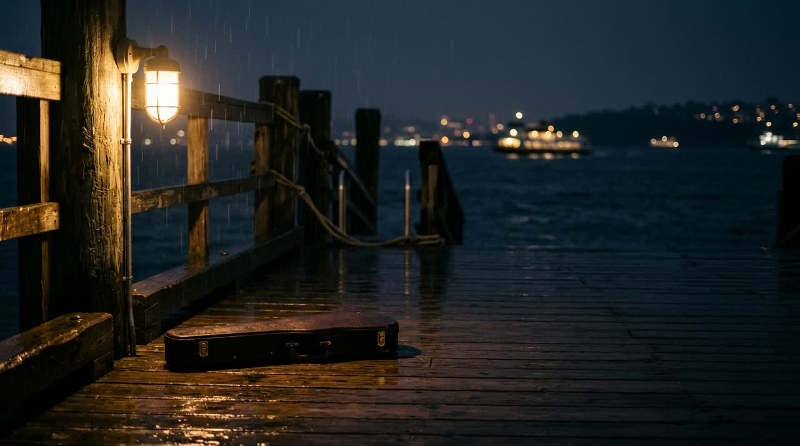

# Narrator Studio

台本を貼ると、声・絵・字幕まで入った語りの動画になります。下の3本は、その見本です。動機の話ではありません。

## 見本

### The Blue Ticket

  

▶ 音声つき: [docs/showcase/blue-ticket.mp4](docs/showcase/blue-ticket.mp4)

港の映画館に、破られていない青い切符が1枚残っている。木曜の夜、映写係はそのフィルムを空席に向けて回す。今夜、4列目の女性が、俳優より先に次の台詞をささやく。

### Salt on the Window

  

▶ 音声つき: [docs/showcase/salt-on-the-window.mp4](docs/showcase/salt-on-the-window.mp4)

船の厨房で、コックがムール貝を上げる。客がレシピを聞く。ナプキンに書いた3語は、朝には消えている。

### The Map in the Case

  

▶ 音声つき: [docs/showcase/map-in-the-case.mp4](docs/showcase/map-in-the-case.mp4)

最終便のあとに、濡れた埠頭へバイオリンケースが残る。中にあるのは楽器ではなく、この町にない道の地図。

台本と画面の説明は [docs/showcase](docs/showcase/README.md)。

## 画面

英語の Create ページです。左に台本、右に声と絵の設定。

  

## 起動

`start.command` をダブルクリック → ブラウザで http://localhost:8510 が開きます。

## フォルダ

| フォルダ | 中身 |
|---|---|
| `scripts/` | 作成ページで書いた台本（タイトル.txt） |
| `media/stock` | Pexels の映像（未使用） |
| `media/stock_used` | 使用済みの映像 |
| `media/anime` | アニメ素材（雰囲気ごと。`tools/sort_anime.py` で振り分け） |
| `media/ai_illustrations` | AI で描いたイラスト（作り直すときに使い回す） |
| `media/photos` / `media/commons` | サムネイル用の写真 / Wikimedia の写真 |
| `media/music` | BGM（CC BY の無料曲） |
| `output/videos` | できた動画・サムネイル・説明文 |
| `output/posting` | 投稿用にまとめたフォルダ（video.mp4・thumbnail.jpg・post.txt） |
| `config/` | 設定・画面の状態・プリセット |
| `docs/` | 見本とメモ |
| `tools/` | 補助スクリプト |
