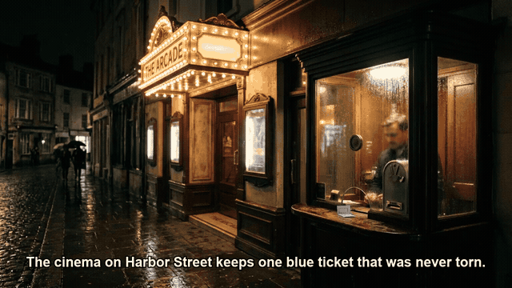
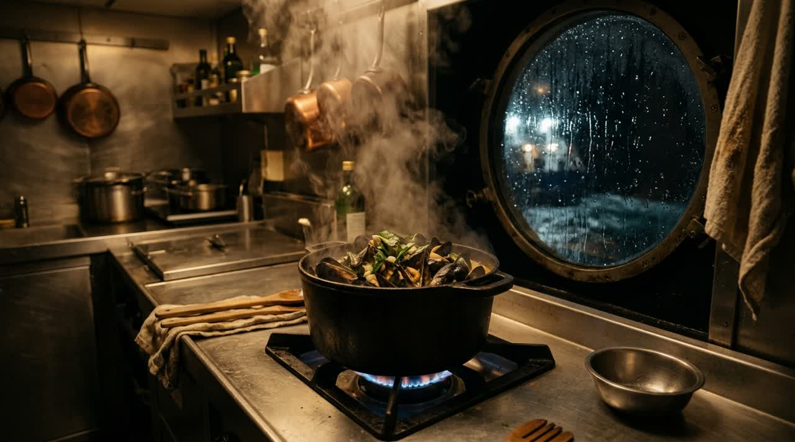
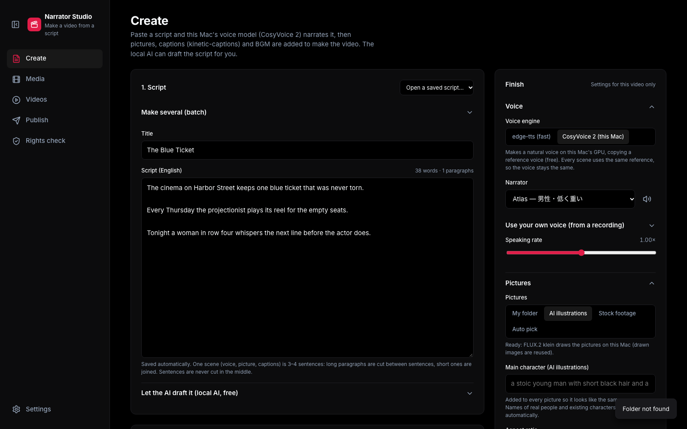

# Narrator Studio

Paste a script. The app turns it into a narrated short: voice, pictures, and captions. The three films below are samples. They are stories, not motivation talks.

## Samples

### The Blue Ticket

  

▶ With sound: [docs/showcase/blue-ticket.mp4](docs/showcase/blue-ticket.mp4)

A cinema on the harbor keeps one blue ticket that was never torn. On Thursday nights the projectionist plays its reel to empty seats. Tonight a woman in row four whispers the next line before the actor does.

### Salt on the Window

  

▶ With sound: [docs/showcase/salt-on-the-window.mp4](docs/showcase/salt-on-the-window.mp4)

In a ferry galley, the cook lifts mussels from a black pot. A passenger asks for the recipe. The three words on the napkin are gone by morning.

### The Map in the Case

  

▶ With sound: [docs/showcase/map-in-the-case.mp4](docs/showcase/map-in-the-case.mp4)

After the last ferry, a violin case is left on the wet dock. Inside is not a violin. It is a map of streets this town does not have.

Scripts and the screen notes: [docs/showcase](docs/showcase/README.md).

## The screen

This is the Create page in English. The script is on the left. Voice and picture settings are on the right.

  

## Start

Double-click `start.command`. The browser opens http://localhost:8510.

## Folders

| Folder | What is in it |
|---|---|
| `scripts/` | Scripts written on the Create page (`title.txt`) |
| `media/stock` | Unused Pexels clips |
| `media/stock_used` | Clips already used |
| `media/anime` | Anime clips, sorted by mood |
| `media/ai_illustrations` | Drawn pictures, reused on a remake |
| `media/photos` / `media/commons` | Photos for thumbnails / Wikimedia |
| `media/music` | Music (CC BY) |
| `output/videos` | Finished videos, thumbnails, descriptions |
| `output/posting` | A folder ready to post (`video.mp4`, `thumbnail.jpg`, `post.txt`) |
| `config/` | Settings, screen state, presets |
| `docs/` | Samples and notes |
| `tools/` | Helper scripts |

## License

[MIT](LICENSE)
