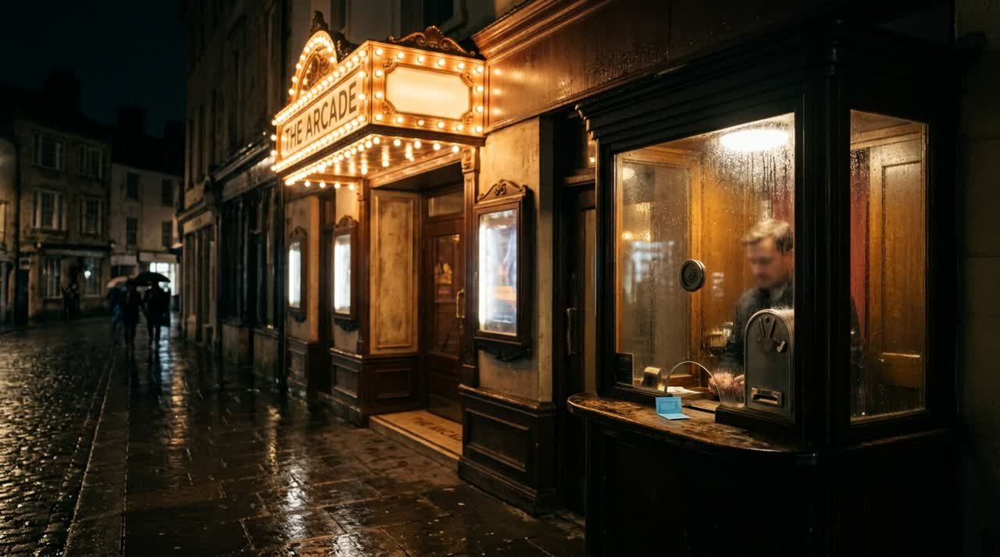
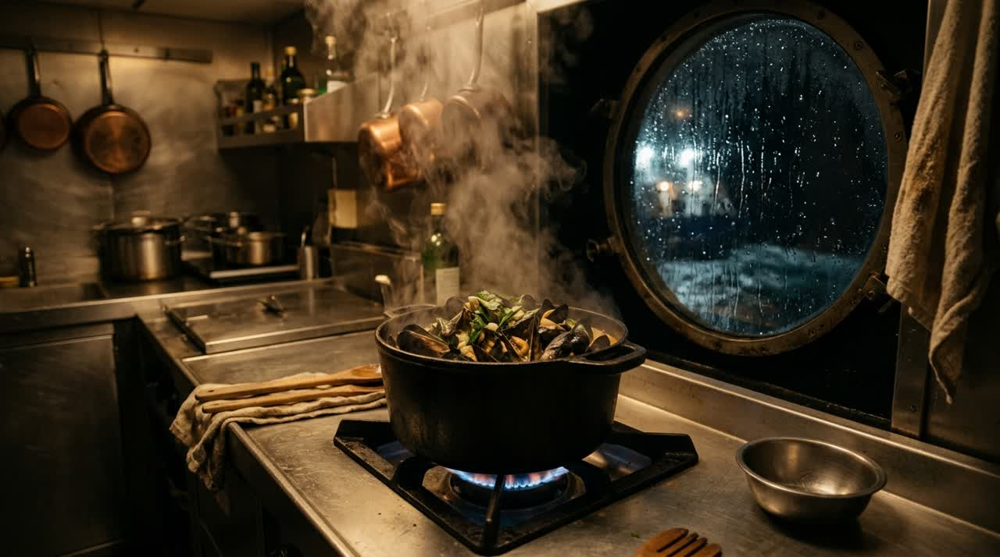
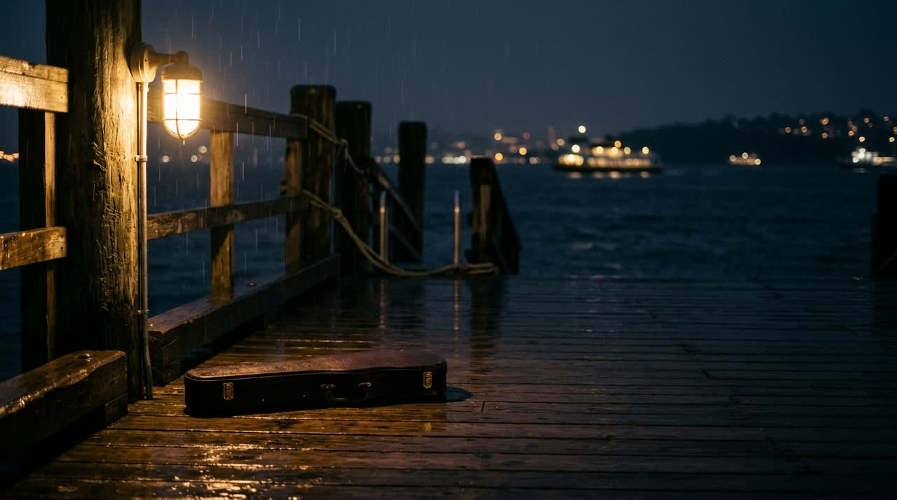
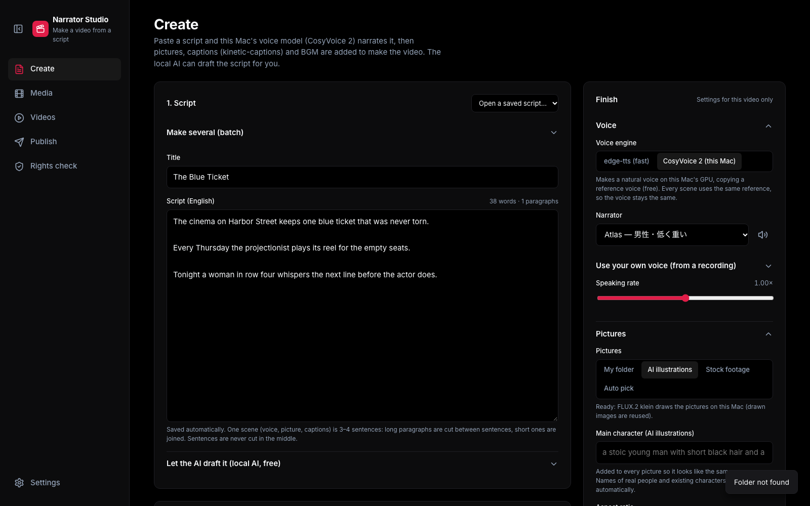

# What this tool makes

短い物語の見本です。動機・自己啓発ではありません。絵と声は Gemini で作りました。下の画面は、このアプリの英語 UI です。

Three short story films. Each one is a narration over pictures. They are not motivation talks.

Pictures: Gemini image. Voice: Gemini speech. The files below are the results.

## The Blue Ticket

[Watch the video](blue-ticket.mp4)

The cinema on Harbor Street keeps one blue ticket that was never torn. Every Thursday the projectionist plays its reel for the empty seats. Tonight a woman in row four whispers the next line before the actor does.

## Salt on the Window

[Watch the video](salt-on-the-window.mp4)

Rain writes down the galley window while the cook lifts mussels from a black pot. A passenger asks for the recipe. He writes three words on a napkin: tide, butter, wait. By morning the napkin is blank, and the pot is clean.

## The Map in the Case

[Watch the video](map-in-the-case.mp4)

The last ferry leaves a violin case on the wet dock. The night guard opens it and finds no violin, only a map of streets this town does not have. The map leads to a door behind the fish market, and the sound of someone tuning a string.

## This is the UI

The Create page, in English. You paste a script. This Mac can then add a voice, pictures, captions, and music.

